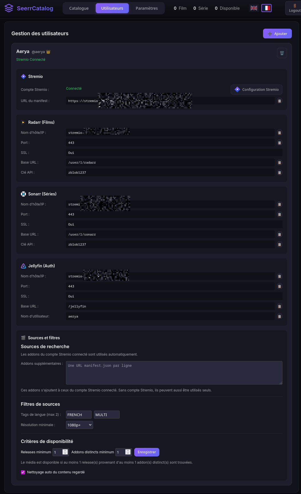
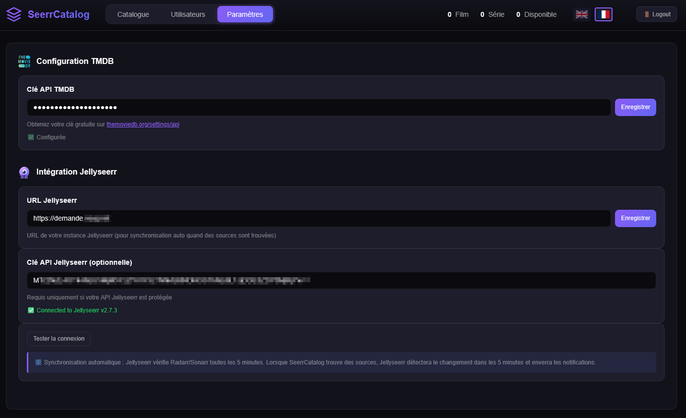
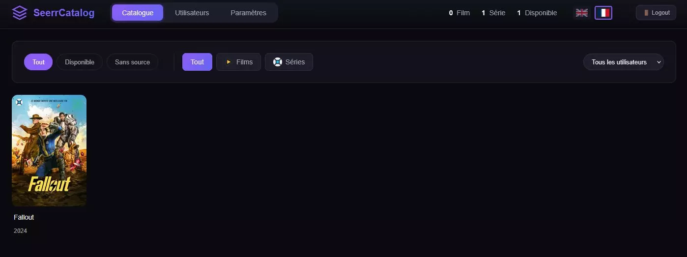
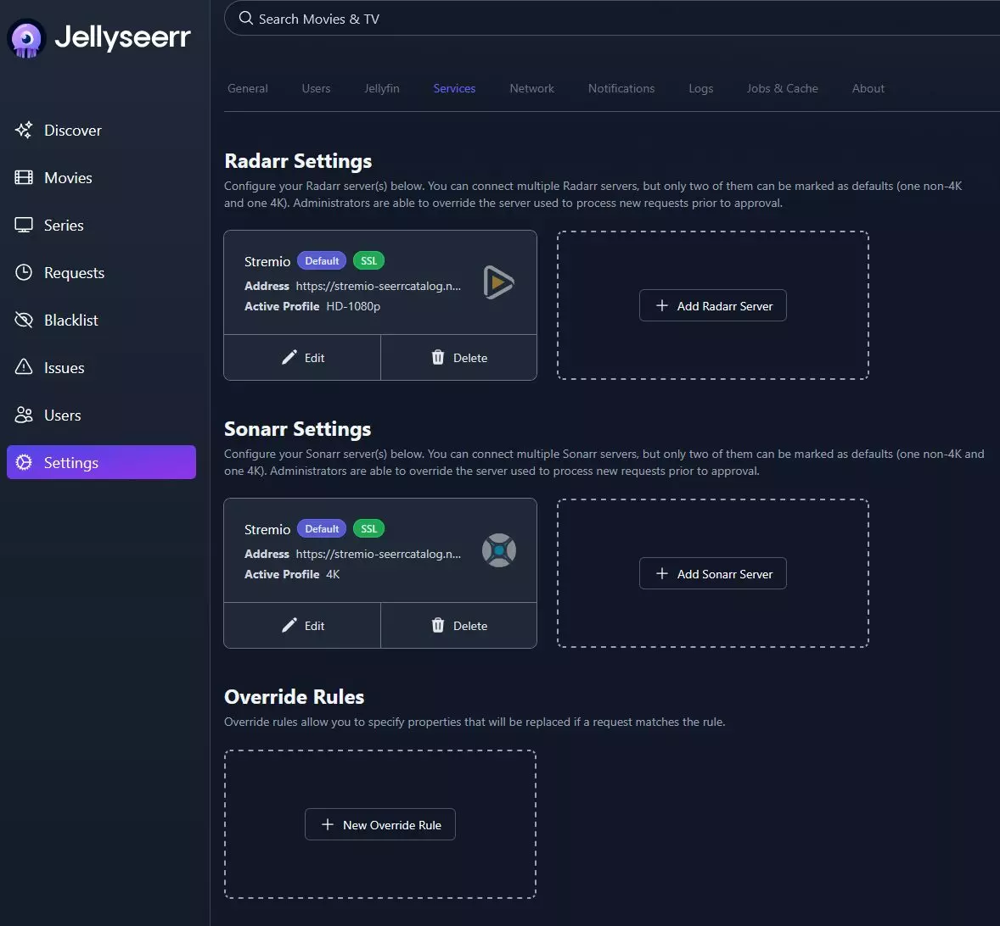
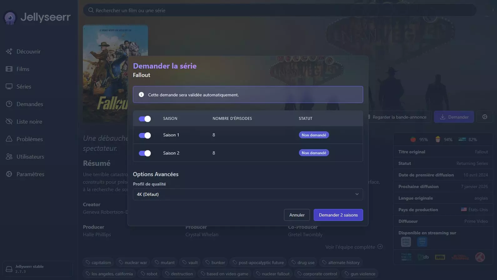
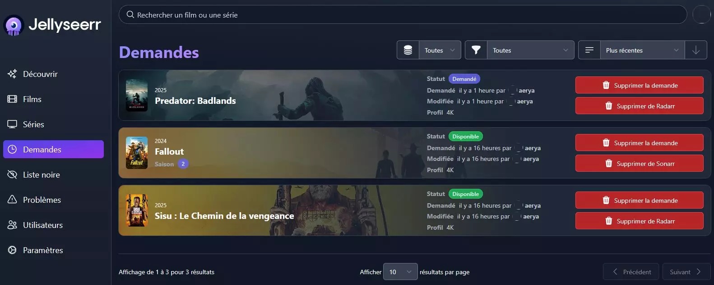
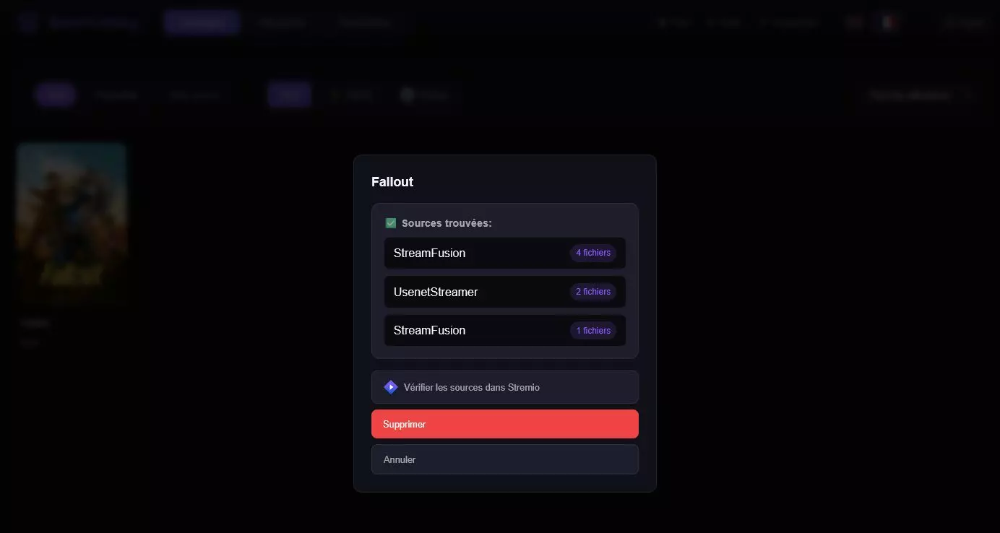
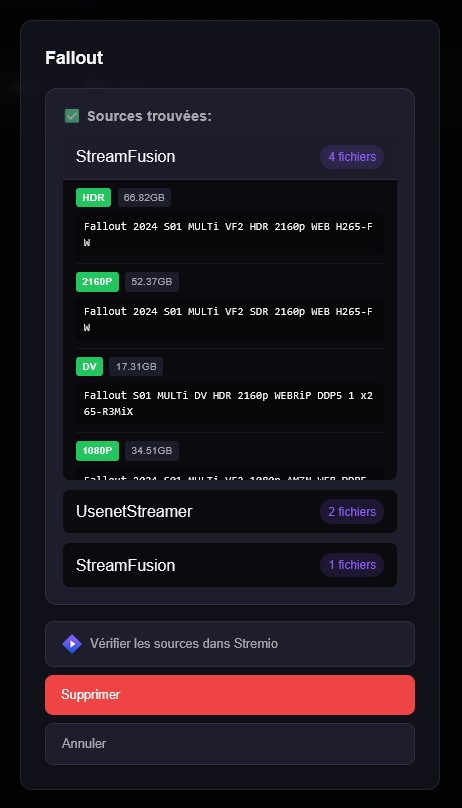
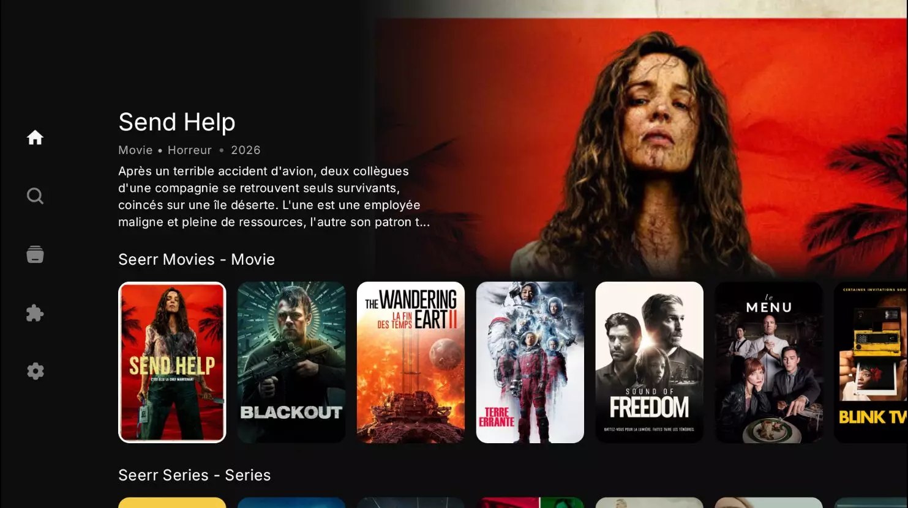

# SeerrCatalog

[Version française](README.md)

**A bridge between Jellyseerr and Stremio that turns media requests into a personal catalog, without SeerrCatalog downloading or storing media files.**

[](https://github.com/Aerya/Stremio-Seerr-Catalog/pkgs/container/stremio-seerr-catalog)
[](README.md)
[](LICENSE)

SeerrCatalog sits between Jellyseerr, Stremio and your streaming sources. It exposes Jellyseerr requests through Jellyfin / Radarr / Sonarr compatible APIs, builds a personal Stremio catalog and checks actual stream availability before marking media as available.

## Contents

- [How it works](#how-it-works)
- [Features](#features)
- [Installation](#installation)
- [Configuration](#configuration)
- [Availability rules](#availability-rules)
- [Ether Remix integration](#ether-remix-integration)
- [Discord notifications](#discord-notifications)
- [Screenshots](#screenshots)
- [Environment variables](#environment-variables)
- [Updating](#updating)
- [Security](#security)
- [Documentation](#documentation)

## How it works

```text
Jellyseerr
    |
    v
SeerrCatalog
    |
    +-- Personal Stremio catalog
    |
    +-- Release availability check
            |
            +-- Stremio account addons
            +-- Additional addons (manifest.json)
                    |
                    v
            Language / resolution filters
                    |
                    v
            Release threshold + distinct addon threshold
                    |
                    v
            Available / No source
```

Additional addons do not replace the addons from the connected Stremio account: **they are added to them**.

For example, if the Stremio account uses AIOStreams and Lumio, StreamFusion and StreamNZB are added manually, SeerrCatalog queries all of those sources.

Without a connected Stremio account, manually configured manifests can also be used on their own for availability checks. A Stremio account is still required for account-dependent features such as watched-state synchronization.

## Features

| Feature | Description |
|---|---|
| Stremio catalog | Jellyseerr requests become a personal catalog available in Stremio. |
| Jellyseerr compatibility | Emulates the Jellyfin, Radarr and Sonarr APIs used by Jellyseerr. |
| Stremio account addons | Addons exposing a `stream` resource are automatically loaded from the connected account. |
| Additional addons | Add compatible Stremio `manifest.json` URLs manually. |
| Addon compatibility | Works with addons such as AIOStreams, Lumio, StreamFusion, StreamNZB, LooStream and WaStream. |
| Filters | Filter releases by language tags and minimum resolution. |
| Configurable availability | Set the minimum release count and minimum distinct addon count per user. |
| Multi-user | Catalog, sources, filters and availability rules are isolated per user. |
| Automatic retry | Media without sources is checked again daily. |
| Watched synchronization | Content watched at 90% or more can be automatically removed from the catalog. |
| Discord notifications | Sources found, confirmed missing sources and catalog removals. |
| WebUI | Responsive French and English interface. |
| Ether Remix (opt-in) | Secure export of recently checked availability and stream descriptors without another addon lookup. |

## Installation

### Docker user and existing volumes

The image now runs as `node` (UID/GID `1000:1000`). **Before updating an existing installation with root-owned data**, add `user: "0:0"` to the `seerr-catalog` service in your current Compose file. With the Compose file provided here, set `CONTAINER_USER=0:0` in `.env` instead. Keep your existing volume paths, environment variables and secrets. This compatibility mode retains root execution; the TLS fix still applies.

For a new installation, use an empty named volume mounted at `/app/data` (Docker initializes it with the image permissions), or prepare a bind directory writable by `1000:1000`. Existing custom users remain supported via `user: "UID:GID"`. No startup script changes ownership or permissions. Do not recursively change ownership of existing volumes. Plan the image replacement separately; updating these files alone does not migrate running containers.

```yaml
services:
  seerr-catalog:
    image: ghcr.io/aerya/stremio-seerr-catalog:latest
    user: "${CONTAINER_USER:-1000:1000}"
    container_name: seerr-catalog
    ports:
      - "7000:7000"
    environment:
      - BASE_URL=http://localhost:7000
      - API_KEY=
      - PORT=7000
      - HOST=0.0.0.0
      - TMDB_API_KEY=
    volumes:
      - /mnt/Docker/stremio/seerrcatalog:/app/data
    restart: always
```

Start:

```bash
docker compose up -d
```

## Configuration

1. Open `http://localhost:7000`.
2. Create the administrator account.
3. Configure the TMDB key.
4. Connect a Stremio account if you want to automatically use its addons and watched synchronization.
5. Under **Users > Sources & filters**, configure additional addons, filters and availability thresholds when needed.
6. Configure Jellyseerr with the Radarr / Sonarr information displayed by SeerrCatalog.
7. Install the SeerrCatalog manifest in Stremio.

### Search sources

For each user:

- addons from the connected Stremio account are loaded automatically;
- manifests entered under **Additional addons** are added to the same pool;
- the same Stremio transport is queried only once if it appears in both lists;
- filters are applied to returned releases;
- availability thresholds are evaluated against the combined result.

Manifest URLs are stored per user.

### Connecting to Seerr / Jellyseerr

In settings, enter a Seerr URL reachable from the SeerrCatalog container (for example `http://seerr:5055` on a shared Docker network) and the key from Seerr’s **Settings > General**. Save, then run the connection test.

The test checks Seerr availability and, when a key is provided, access to its protected API. Without a key, only connectivity is checked. Your SeerrCatalog web session is separate from this API key.

## Availability rules

Two independent values determine when media is considered available:

- **Min releases**: total number of releases matching the filters.
- **Min distinct addons**: number of different sources that must return at least one release.

| Min releases | Min addons | Example |
|---:|---:|---|
| 1 | 1 | At least one release from one source. |
| 2 | 1 | At least two releases, even from a single addon. |
| 1 | 2 | At least two different addons must return a release. |
| 3 | 2 | At least three releases in total from at least two addons. |

Both values default to `1`, preserving the previous behavior.

### Check reliability and notifications

- Following a Radarr/Sonarr addition, SeerrCatalog checks streams in the background and makes **one confirmation attempt after 60 seconds** if availability is not confirmed. The Jellyseerr creation response remains immediate.
- Network errors, timeouts, unavailable addons and missing IMDB IDs are **incomplete checks**, not evidence of missing streams. A failed check does not overwrite previously saved results.
- A Discord **“No Source Found”** alert is sent only after two conclusive checks find **zero releases matching the filters**. Releases that fail the configured minimum thresholds keep the media unavailable **without a misleading “No Source” alert**.
- Series checks try monitored seasons (up to two recent seasons) before falling back to `S01E01`, instead of always using `S01E01`.
- Direct addon manifests and Stremio account addon lists are cached for 60 seconds to reduce repeated requests during bulk additions. Stream lookups are limited to 4 concurrent requests, without configuration changes.
- Copy buttons show an inline check mark instead of a popup. Incomplete manual checks are shown in the media details without overwriting earlier results.

## Ether Remix integration

The integration is **disabled by default**. [Ether Remix](https://github.com/Aerya/Ether-Remix) can reuse results already retrieved by SeerrCatalog instead of querying the same addons again just to check catalogue availability.

1. Open **Settings → Ether Remix integration**, generate a shared token, and copy it into Remix.
2. Enable and save the export. The read-only feed URL appears in that section.
3. Optionally enter the complete Remix event receiver URL to push every conclusive check; otherwise Remix can periodically poll the feed.
4. Items checked **before enablement** need another check for exportable data. Enabling does not trigger a bulk lookup.

In [Ether Remix](https://github.com/Aerya/Ether-Remix), open **Sources → Stremio → SeerrCatalog → Ether Remix**, enter the SeerrCatalog base address and the same token, then enable and save. Remix synchronizes every minute and trusts SeerrCatalog availability criteria for these titles, including “playable only”. Other visibility rules and viewer playback policies remain in force.

While export is enabled, SeerrCatalog also rechecks already available items after 24 h (hourly wake-up). The 26 h validity allows for scheduling; prolonged outages let observations expire. Inconclusive checks do not extend their lifetime. Disabling restores normal checks of unavailable items only.

The token accesses results for all users of this instance: connect only your trusted instances. Recent HTTP sources and torrent hashes are reused for playback; otherwise, or after failure, Remix falls back to ordinary discovery. Provider permissions, network access and restrictions must allow playback from Remix.

### v1 API contract

Paginated read with `Authorization: Bearer <token>`:

```http
GET /api/integrations/remix/v1/availability?after=0&limit=50
Authorization: Bearer <integration-token>
```

The response is `{ "schema": "seerrcatalog.availability.v1", "revision": 12, "items": [<snapshot>], "nextCursor": null }`. `after` is the last numeric media ID, with a page size between 1 and 100. Each snapshot includes:

- `media: { id, userId, type, imdbId, tmdbId, title, year }`;
- `available`, `checkStatus`, `checkedAt`, `expiresAt` and `releasesExpireAt`;
- `streamCount`, `addonsCount`, `appliedFilters`, `requirements`;
- `releases` containing `addonId`, `addonName`, exact Stremio `streamId` (series include season and episode), `name`, `title`, `quality`, `size`, and a limited `stream` descriptor (`url`, `infoHash`, etc.).

Only conclusive, non-expired checks are exported. Signed stream URLs and headers are removed from the export after at most **30 minutes** (they may stop working earlier), while stable torrent hashes can remain until the availability observation expires after **26 hours**. Stream links potentially containing credentials are kept out of the ordinary catalogue/media APIs.

Every synchronization starts at `after=0`. Pass the returned `revision` on subsequent pages (`&revision=12`); HTTP 409 means restart. Replace local observations only after completing every page, removing absent media. The cursor is a media ID, **not an incremental change log**. This full reconciliation recovers missed deletions.

With a receiver configured, SeerrCatalog sends an authenticated `POST` to the **full URL configured by the admin**. Its body is `{ "schema": "seerrcatalog.availability.v1", "event": "availability.updated", "data": <snapshot> }`, or `event: "media.removed"` with `data.media`. A failing receiver never interrupts catalogue updates; polling catches up after outages. The Remix receiver is available at `/api/integrations/seerrcatalog/v1/events`. Events trigger a full feed refresh, so duplicate or out-of-order notifications cannot overwrite newer observations.

For a series, a result for an episode is **not** proof that the whole series is playable. Addon results are source observations, not guaranteed playback; Remix must apply its own policies and fall back to normal discovery when streams are expired or unusable. At most 10 releases per addon and 50 per media are exported. Stream URLs and headers may contain private access tokens: only connect a trusted Remix instance and use HTTPS outside a private network. Disabling clears stored snapshots; rotating the token invalidates the previous one immediately.

## Discord notifications

Discord webhooks report **sources found** (initial, manual or automatic checks), **confirmed missing sources** on addition, and **content removals** (watched cleanup, WebUI deletion, Radarr/Sonarr removal). Repeated checks without a status transition do not trigger duplicates. **Sources Found** alerts show the **filters actually applied** (languages and minimum resolution), source count, addons, and **releases grouped by addon** (name, quality and size when available). Checks retain up to 50 release names per addon; Discord splits the list over fields and reports how many releases could not be displayed due to embed limits. Notifications include IMDb/TMDB links. Marking an item as watched without removing it is not a removal. Enable notifications and choose their language in settings.

<!-- screenshots:start -->
## Screenshots

### SeerrCatalog WebUI

<p align="center">
  
</p>
<p align="center"><sub>
Complete per-user configuration: Stremio account, Radarr / Sonarr / Jellyfin endpoints, additional addons, filters and availability criteria.
</sub></p>

<table>
  <tr>
    <td width="50%" align="center"><strong>SeerrCatalog settings</strong></td>
    <td width="50%" align="center"><strong>Catalog</strong></td>
  </tr>
  <tr>
    <td></td>
    <td></td>
  </tr>
  <tr>
    <td align="center"><sub>TMDB configuration and Jellyseerr integration.</sub></td>
    <td align="center"><sub>Personal catalog with availability, media type and user filters.</sub></td>
  </tr>
</table>

### Jellyseerr integration

<table>
  <tr>
    <td width="50%" align="center"><strong>Radarr / Sonarr services</strong></td>
    <td width="50%" align="center"><strong>Creating a request</strong></td>
  </tr>
  <tr>
    <td></td>
    <td></td>
  </tr>
  <tr>
    <td align="center"><sub>Jellyseerr points to the Radarr and Sonarr endpoints emulated by SeerrCatalog.</sub></td>
    <td align="center"><sub>Requests are still created normally from Jellyseerr.</sub></td>
  </tr>
</table>

<p align="center">
  
</p>
<p align="center"><sub>
Requests automatically become available once SeerrCatalog validates the configured source criteria.
</sub></p>

### Source detection

<p align="center">
  
</p>
<p align="center"><sub>
Compact view of the addons that returned releases and the number of matching results.
</sub></p>

<p align="center">
  
</p>
<p align="center"><sub>
Detailed release information including addon, quality, size and release name.
</sub></p>

### Stremio and compatible clients

<p align="center">
  
</p>
<p align="center"><sub>
Catalogs generated by SeerrCatalog can be consumed by Stremio-addon-compatible clients, shown here in Nuvio.
</sub></p>
<!-- screenshots:end -->

## Environment variables

| Variable | Description | Default |
|---|---|---|
| `PORT` | SeerrCatalog HTTP port | `7000` |
| `HOST` | Listening interface | `0.0.0.0` |
| `TMDB_API_KEY` | TMDB API key used for metadata | — |
| `BASE_URL` | Public URL, especially behind a reverse proxy | auto-detected |
| `API_KEY` | API key exposed to compatible clients | — |

## Updating

Before updating, check [volume permissions and the Docker user](#docker-user-and-existing-volumes), especially for an older installation running as root.

With Docker Compose:

```bash
docker compose pull
docker compose up -d --force-recreate
```

A plain `docker compose restart` is not enough after a `pull`: it restarts the existing container with the image it was created from.

With Dockge / Dockge-Enhanced, use **Pull & Recreate** to apply a newly downloaded image.

## Security

Some `manifest.json` URLs may contain private tokens, keys or configuration parameters.

- Do not publish these URLs.
- Protect the `/app/data` volume, which contains application settings.
- Use HTTPS when the instance is exposed through a reverse proxy.
- Set `BASE_URL` to the public URL when SeerrCatalog runs behind a proxy.

### TLS security — October 2026

Update image trust stores and TLS components following the eMudhra incident. Checks cover the compromised chains, including both No CT cases, and a valid HTTPS connection. Running images remain unchanged: schedule their replacement after validation.

[Incident details](https://emudhra.we-have-a-problem.com/) · [TLS checks](security/emudhra/README.md)

## Documentation

Article and screenshots: [UpAndClear — SeerrCatalog, the Over/Jelly/Seerr addon for Stremio](https://upandclear.org/2026/01/03/seerrcatalog-laddon-over-jelly-seerr-pour-stremio/)

Docker image: [ghcr.io/aerya/stremio-seerr-catalog](https://github.com/Aerya/Stremio-Seerr-Catalog/pkgs/container/stremio-seerr-catalog)

## Project

Developed and maintained by [Aerya](https://github.com/Aerya).

Website: [UpAndClear](https://upandclear.org/)

If SeerrCatalog is useful to you, you can support the project by starring the repository.

## License

MIT — see [LICENSE](LICENSE).
