# SeerrCatalog

[English version](README.en.md)

**Passerelle entre Jellyseerr et Stremio pour transformer les demandes de médias en catalogue personnel, sans téléchargement ni stockage de médias par SeerrCatalog.**

[](https://github.com/Aerya/Stremio-Seerr-Catalog/pkgs/container/stremio-seerr-catalog)
[](README.en.md)
[](LICENSE)

SeerrCatalog se place entre Jellyseerr, Stremio et tes sources de streaming. Il expose les demandes Jellyseerr via une API compatible Jellyfin / Radarr / Sonarr, construit un catalogue Stremio personnel et contrôle la disponibilité réelle des médias avant de les déclarer disponibles.

## Sommaire

- [Fonctionnement](#fonctionnement)
- [Fonctionnalités](#fonctionnalités)
- [Installation](#installation)
- [Configuration](#configuration)
- [Règles de disponibilité](#règles-de-disponibilité)
- [Intégration Ether Remix](#intégration-ether-remix)
- [Notifications Discord](#notifications-discord)
- [Captures d’écran](#captures-décran)
- [Variables d’environnement](#variables-denvironnement)
- [Mise à jour](#mise-à-jour)
- [Sécurité](#sécurité)
- [Documentation](#documentation)

## Fonctionnement

```text
Jellyseerr
    |
    v
SeerrCatalog
    |
    +-- Catalogue Stremio personnel
    |
    +-- Vérification des releases
            |
            +-- Addons du compte Stremio
            +-- Addons supplémentaires (manifest.json)
                    |
                    v
            Filtres langue / résolution
                    |
                    v
            Seuil releases + seuil addons distincts
                    |
                    v
            Disponible / Sans source
```

Les addons supplémentaires ne remplacent pas les addons du compte Stremio : **ils s'y ajoutent**.

Exemple : si le compte Stremio utilise AIOStreams et que Lumio, StreamFusion et StreamNZB sont ajoutés manuellement, SeerrCatalog interroge l'ensemble de ces sources.

Sans compte Stremio lié, les manifests ajoutés manuellement peuvent également être utilisés seuls pour la vérification de disponibilité. Le compte Stremio reste nécessaire aux fonctions qui dépendent du compte, notamment la synchronisation de l'état regardé.

## Fonctionnalités

| Fonction | Description |
|---|---|
| Catalogue Stremio | Les demandes Jellyseerr deviennent un catalogue personnel ; option pour n’afficher que les contenus disponibles. |
| Compatibilité Jellyseerr | Émulation des API Jellyfin, Radarr et Sonarr utilisées par Jellyseerr. |
| Multi-utilisateurs | Catalogue, sources, filtres et critères de disponibilité propres à chaque utilisateur. |
| Addons du compte Stremio | Récupération automatique des addons proposant une ressource `stream` depuis le compte lié. |
| Addons supplémentaires | Ajout de manifests compatibles, utilisables avec ou sans compte Stremio connecté. |
| Compatibilité addons | Fonctionne notamment avec AIOStreams, Lumio, StreamFusion, StreamNZB, LooStream et WaStream. |
| Langues et résolution | Tags de langues principales et résolution minimale configurables par utilisateur. |
| Repli sous-titré | Sans résultat dans les langues principales, repli facultatif sur des tags modifiables ; `VOSTFR` et `SUBFRENCH` sont des exemples préremplis. |
| Disponibilité définitive | Au moins deux releases distinctes pour la validation automatique, avec seuils de releases et d’addons configurables. Un média confirmé reste disponible jusqu’à sa suppression. |
| Recherche progressive | Une release : contrôles à J+1 puis J+3, puis quotidiens. Zéro release : recherche quotidienne jusqu’à trouver. Pas de recontrôle automatique des médias déjà disponibles. |
| Validation manuelle | Possibilité de confirmer définitivement un média dès qu’une seule release répond aux filtres. |
| Alertes de validation | Après J+1/J+3 avec une seule release, notification Discord et/ou Apprise, avec mention Discord facultative. |
| Recherche Prowlarr | Connecteur autonome facultatif pour compléter les recherches, sans nécessiter Remix. |
| Recherche via Ether Remix | Recherche complémentaire authentifiée dans les sources de [Remix](https://github.com/Aerya/Ether-Remix), notamment Prowlarr. |
| Partage avec Ether Remix | Export des disponibilités confirmées et des releases récentes, pour éviter une nouvelle recherche de disponibilité. Activation et clé indépendantes de la recherche via Remix. |
| Sous-titres SubMaker | Via Remix, recherche et traduction facultatives sur une instance [SubMaker](https://github.com/xtremexq/StremioSubMaker) publique ou auto-hébergée ; langue cible configurable et validation seulement après réception du SRT correspondant à la release. |
| Sous-titres dans Stremio | Distribution des SRT conservés pour les médias disponibles, lorsque le lecteur transmet le nom correspondant de la vidéo. |
| Repérage des versions sous-titrées | Badge sur les affiches, filtre dédié et indication des traductions IA ; relance manuelle possible avec les seuls tags de langues principales. |
| Suivi du catalogue | Compteurs films, séries, disponibles et en recherche ; filtres par disponibilité, type de média et utilisateur. |
| Synchronisation regardé | Nettoyage facultatif du catalogue pour les contenus regardés à au moins 90 %. |
| Notifications Discord | Notifications de sources trouvées et de retraits du catalogue, en plus des alertes de validation. |
| WebUI personnalisable | Interface responsive en français et en anglais, modes Jour/Nuit/Auto et cinq palettes de couleurs. |

## Installation

### Utilisateur Docker et volumes existants

L’image s’exécute désormais avec `node` (UID/GID `1000:1000`). **Avant de mettre à jour une installation dont les données appartiennent à root**, ajouter `user: "0:0"` au service `seerr-catalog` dans son Compose actuel. Avec le Compose fourni ici, définir plutôt `CONTAINER_USER=0:0` dans `.env`. Conserver les chemins des volumes, les variables et les secrets existants. Ce mode de compatibilité conserve l’exécution en root ; le correctif TLS reste appliqué.

Pour une nouvelle installation, utiliser un volume nommé vide monté sur `/app/data` (Docker reprend les permissions de l’image), ou préparer un répertoire bind accessible en écriture à `1000:1000`. Les utilisateurs personnalisés restent possibles avec `user: "UID:GID"`. Aucun script de démarrage ne change les propriétaires ou permissions. Ne pas appliquer de changement récursif de propriétaire aux volumes existants. Le remplacement de l’image reste à planifier séparément ; modifier ces fichiers ne migre pas les conteneurs en cours.

```yaml
services:
  seerr-catalog:
    image: ghcr.io/aerya/stremio-seerr-catalog:latest
    user: "${CONTAINER_USER:-1000:1000}"
    container_name: seerr-catalog
    ports:
      - "7000:7000"
    environment:
      - BASE_URL=http://localhost:7000
      - API_KEY=
      - PORT=7000
      - HOST=0.0.0.0
      - TMDB_API_KEY=
    volumes:
      - /mnt/Docker/stremio/seerrcatalog:/app/data
    restart: always
```

Démarrage :

```bash
docker compose up -d
```

## Configuration

1. Ouvre `http://localhost:7000`.
2. Crée le compte administrateur.
3. Configure la clé TMDB.
4. Lie un compte Stremio si tu veux utiliser automatiquement ses addons et la synchronisation de lecture.
5. Dans **Utilisateurs > Sources et filtres**, configure si nécessaire les addons supplémentaires, les filtres et les seuils de disponibilité.
6. Configure Jellyseerr avec les informations Radarr / Sonarr affichées par SeerrCatalog.
7. Installe le manifest SeerrCatalog dans Stremio.

### Sources de recherche

Pour chaque utilisateur :

- les addons du compte Stremio connecté sont chargés automatiquement ;
- les manifests saisis dans **Addons supplémentaires** sont ajoutés au même pool ;
- un même transport Stremio n'est interrogé qu'une fois s'il apparaît dans les deux listes ;
- les filtres sont appliqués aux releases retournées ;
- les seuils de disponibilité sont évalués sur le résultat combiné.

Les URLs de manifests sont propres à chaque utilisateur.

### Connexion à Seerr / Jellyseerr

Dans les paramètres, renseigne l’URL de Seerr accessible depuis le conteneur SeerrCatalog (par exemple `http://seerr:5055` sur un réseau Docker commun) et la clé disponible dans **Settings > General** de Seerr. Enregistre puis lance le test de connexion.

Le test vérifie la disponibilité de Seerr et, si une clé est renseignée, son accès à l’API protégée. Sans clé, seule la connexion est vérifiée. La session de connexion à l’interface SeerrCatalog est indépendante de cette clé.

## Règles de disponibilité

Deux valeurs indépendantes déterminent quand un média est considéré comme disponible :

- **Releases minimum** : nombre total de releases correspondant aux filtres.
- **Addons distincts minimum** : nombre de sources différentes devant retourner au moins une release.

| Releases minimum | Addons minimum | Exemple de règle |
|---:|---:|---|
| 2 | 1 | Valeur par défaut : deux releases distinctes, même depuis un seul addon. |
| 2 | 2 | Deux releases distinctes, provenant d’au moins deux addons. |
| 3 | 2 | Trois releases distinctes, provenant d’au moins deux addons. |

La validation automatique nécessite **au moins deux releases**. Les anciennes valeurs à `1` sont relevées à `2` pour les titres encore en recherche. Un même hash torrent, nom de fichier ou une même URL renvoyée plusieurs fois ne compte qu’une fois. Les critères plus stricts restent possibles. Les titres déjà disponibles sont conservés.

### Disponibilité définitive et recherche progressive

- Dès qu’un titre atteint les critères, il est **disponible jusqu’à sa suppression**. Aucun recontrôle ne peut lui retirer ce statut : ni la tâche planifiée, ni une consultation Jellyfin, ni Remix, ni un changement de filtres. Il n’y a pas de recherche d’une meilleure version.
- Avec **une release**, nouvelles vérifications à **J+1 puis J+3**, depuis la première détection de cette release unique. Les échéances sont enregistrées en SQLite et survivent au redémarrage. Le planificateur se réveille chaque heure ; une coupure peut donc retarder une échéance. Les contrôles manuels restent possibles sans avancer prématurément les étapes.
- Si une seule release subsiste après ces deux contrôles, une **alerte de validation** est envoyée sur Discord et/ou Apprise. Elle peut mentionner l’identifiant Discord configuré. La recherche continue ensuite quotidiennement, sans répéter une alerte déjà livrée.
- Dans la fiche du titre, **Valider cette release** permet de confirmer définitivement sa disponibilité. Cette action est impossible avec zéro release ; elle est disponible dès la première release, sans attendre J+3.
- Avec **zéro release**, le titre reste **En recherche**, avec une vérification quotidienne, sans notification d’échec définitif. Si aucune release n’est de nouveau trouvée, le cycle d’une release unique repart à sa prochaine détection.
- L’option par utilisateur **Si aucune source ne correspond aux langues principales : utiliser les tags de repli** utilise les mêmes réponses d’addons, sans doubler les appels. Elle s’applique seulement si aucun résultat ne passe les filtres principaux de langue et de résolution ; une release correspondant aux langues principales empêche ce repli. Les deux tags de repli sont modifiables par utilisateur, avec `VOSTFR` et `SUBFRENCH` préremplis comme exemples ; deux champs vides désactivent le repli. Les nouveaux profils utilisent `FRENCH` et `MULTI` par défaut. Les critères de validation sont identiques pour le repli sous-titré.
- Une erreur réseau ou d’addon est une vérification **incomplète** : elle conserve le résultat précédent et ne déclenche pas l’alerte d’une release unique. Le planificateur réessaie à son prochain passage.
- Pour les séries, seules les saisons suivies (jusqu’à deux saisons récentes, puis `S01E01` en repli) sont sondées. Une disponibilité de série ne garantit pas tous les épisodes. Les manifests sont mémorisés 60 secondes et les requêtes de flux limitées à quatre simultanées.

### Apparence

Le bandeau propose les modes **Jour**, **Nuit** et **Auto** (préférence du système), ainsi que cinq palettes : **Violet, Océan, Forêt, Rose et Ambre**. Les choix sont conservés dans ce navigateur, y compris sur l’écran de connexion. Les boutons sont plus fins et les blocs Jellyseerr/Discord restent alignés côte à côte sur ordinateur, puis empilés sur mobile.

### Afficher uniquement les contenus disponibles dans Stremio

Par défaut, le catalogue affiche toutes les demandes, même sans source. Dans **Utilisateurs → Sources et filtres → Critères de disponibilité**, cochez **Afficher uniquement les contenus disponibles dans le catalogue Stremio personnel**, puis cliquez sur **Enregistrer**. Utilisez l’URL d’addon personnelle `/user/<id>/manifest.json` proposée dans la fiche de cet utilisateur ; le manifeste global `/manifest.json` continue d’afficher toutes les demandes.

Le filtre concerne les films, les séries et la recherche, avant pagination. Il utilise la décision de disponibilité confirmée, automatique ou manuelle. Les contenus indisponibles ou jamais vérifiés sont masqués, sans supprimer les demandes ni modifier les API compatibles Radarr/Sonarr. Actualisez Stremio pour renouveler son cache ; un changement des critères ne remet pas en cause les titres déjà validés. Une source trouvée ne garantit pas la lecture et une série disponible ne signifie pas que tous ses épisodes le sont.

Les affiches des contenus disponibles grâce aux langues de repli portent un badge **VOSTFR** pour VOSTFR/SUBFRENCH, ou les tags personnalisés réellement retenus. Le filtre **VOSTFR / langues de repli** permet de les retrouver. Dans leur fiche, **Rechercher les langues principales** relance volontairement une recherche avec les tags principaux actuels du propriétaire (par exemple FRENCH/MULTI), la résolution et les seuils habituels. Si les critères sont atteints, les sources sont remplacées, le badge est retiré et le partage Remix est actualisé. Une erreur, zéro ou trop peu de releases conserve intégralement la disponibilité et les sources de repli. Cette action ne réactive pas les recherches automatiques sur les titres confirmés.

### Recherche complémentaire : Remix ou Prowlarr

Dans **Paramètres**, deux blocs distincts organisent la configuration : **Recherche complémentaire Prowlarr** pour Prowlarr seul, et **Intégration Ether Remix** pour le partage des disponibilités et la recherche via Remix. Chaque fonction Remix possède sa propre activation et sa propre clé. Un seul fournisseur de recherche complémentaire peut être actif : activer Prowlarr remplace Remix, ou inversement, après enregistrement. Enregistrez avant **Tester la connexion** :

- **Ether Remix → Recherche via Remix** : indiquez son adresse de base. Générez une clé dédiée aux recherches dans ce bloc et copiez-la dans **Remix → Sources → Stremio → SeerrCatalog → Recherche via Remix**. Activez les recherches dans Remix et le repli de langue dans les préférences utilisateur, puis enregistrez des deux côtés. Le partage des disponibilités et sa clé sont indépendants et peuvent rester désactivés. Après mise à jour des deux applications, renseignez cette nouvelle clé : l’ancienne clé de partage n’autorise plus la recherche. Après les addons, si aucune release ne correspond aux langues principales, Remix recherche via ses indexeurs configurés, dont Prowlarr. Les budgets d’indexation restent appliqués.
- **Prowlarr autonome** : indiquez son adresse de base et sa clé API. Aucun Remix ni compte Stremio n’est nécessaire. Prowlarr complète les addons lorsqu’ils n’ont aucun résultat principal, ou sert seul. Les langues principales sont prioritaires ; les tags de repli personnalisés s’appliquent seulement si le repli est activé et qu’aucune source principale ne convient.

Les résultats sont dédupliqués avec ceux des addons. Deux releases distinctes confirment définitivement le média ; une seule suit J+1/J+3 avec notification et validation manuelle possible. Les échecs réseau ne concluent pas à une absence de sources. Les résultats utilisables d’une recherche Remix partielle sont conservés et soumis aux mêmes filtres, seuils et déduplication ; si le seuil n’est pas atteint, le contrôle reste incomplet. Un cache de cinq minutes partage les recherches complètes identiques ; aucune recherche complémentaire n’est lancée pour les titres confirmés.

Le connecteur compte uniquement les torrents accompagnés d’un **infoHash** (ou magnet avec hash) et les vrais flux HTTP renvoyés par Remix. Les résultats NZB et les torrents sans hash exploitable ne sont pas comptés ; aucun téléchargement n’est déclenché. La présence d’une release n’est pas une garantie de lecture ni de cache débridé. Prowlarr n’ajoute pas automatiquement ces sources aux addons de lecture Stremio : SeerrCatalog reste un addon de catalogue. Un fournisseur complémentaire compte comme une source pour le seuil minimal de sources.

La clé Prowlarr reste côté serveur et n’est pas renvoyée par les API de paramètres. Le test utilise la configuration enregistrée. Le retour de recherche nécessite une version de [Remix](https://github.com/Aerya/Ether-Remix) prenant en charge `/api/integrations/seerrcatalog/v1/search`.

## Intégration Ether Remix

L'intégration est **désactivée par défaut**. [Ether Remix](https://github.com/Aerya/Ether-Remix) peut réutiliser les résultats déjà récupérés par SeerrCatalog au lieu de relancer une recherche de disponibilité sur les mêmes addons.

1. Dans **Paramètres → Intégration Ether Remix**, générez une clé partagée, puis copiez-la dans Remix.
2. Activez l'export et enregistrez. L’adresse de base à copier dans Remix figure dans cette rubrique, sans chemin `/api/…`. Aucun point de réception Remix n’est à renseigner.
3. Les titres déjà disponibles sont exportés automatiquement, sans recherche supplémentaire et sans renouveler leurs anciens liens de lecture.

Dans [Ether Remix](https://github.com/Aerya/Ether-Remix), ouvrez **Sources → Stremio → SeerrCatalog → Disponibilités vers Remix**, renseignez l’adresse de base de SeerrCatalog et la même clé, puis activez et enregistrez. Remix synchronise chaque minute et fait confiance aux critères de disponibilité de SeerrCatalog pour ces titres, y compris avec « lisible uniquement ». Les autres règles de visibilité et les règles de lecture du spectateur restent appliquées.

Les disponibilités confirmées portent `availabilityConfirmed: true` et restent valides jusqu’à suppression du titre. **Mettez à jour SeerrCatalog et Ether Remix** pour activer ce comportement : les anciennes versions de Remix continuent à expirer les observations après 26 h. Les liens de lecture restent limités à 30 minutes ; cette expiration ne retire pas le titre du catalogue.

La clé donne accès aux résultats de tous les utilisateurs de cette instance : reliez uniquement vos instances de confiance. Les sources HTTP récentes et les hash torrent sont réutilisés à la lecture ; sinon, ou en cas d’échec, Remix retrouve ses recherches habituelles. Les droits, le réseau et les restrictions du fournisseur doivent permettre la lecture depuis Remix.

### VO avec sous-titres SubMaker via Remix

Option désactivée par défaut. Dans **Paramètres → Intégration Ether Remix**, configurez la recherche via Remix et sa clé dédiée. Dans [Remix](https://github.com/Aerya/Ether-Remix), configurez [SubMaker](https://github.com/xtremexq/StremioSubMaker), public ou auto-hébergé, avec son manifeste personnel, les fournisseurs et le moteur de traduction de votre choix. Dans **Utilisateurs → Sources et filtres**, activez les sous-titres externes et choisissez la même langue cible que Remix (`fr` par défaut). Le partage des disponibilités reste indépendant.

Sans release dans les langues principales, Remix peut rechercher des SRT dans la langue cible ou traduire des SRT anglais (langues modifiables). Seuls les fichiers reçus complètement, correspondant au nom de la release, sont retenus. Une traduction conserve les timecodes et le nombre de répliques ; la qualité linguistique et la synchronisation réelle doivent encore être vérifiées à la lecture. Une traduction en cours ou en erreur ne valide rien. Les tâches en attente sont revérifiées après cinq minutes.

Deux releases distinctes avec sous-titres validés peuvent confirmer le média ; une seule conserve J+1/J+3 et la validation manuelle. Résolution et nombre d’addons requis restent appliqués. Le badge indique la langue des sous-titres et `IA` pour une traduction. La recherche « langues principales uniquement » n’utilise pas ce repli ; une disponibilité acquise reste définitive jusqu’à suppression.

Le manifeste expose désormais la ressource `subtitles` : réinstallez l’addon si le client conserve l’ancienne liste. Pour obtenir le SRT associé, le lecteur doit transmettre le `filename` exact de la vidéo. Sans nom correspondant, aucun sous-titre n’est servi. Supprimer le média retire l’accès aux SRT associés. Le manifeste privé SubMaker reste dans Remix ; seul le résultat SRT transite par la recherche authentifiée.

[Guide Remix : configuration, périmètres et limites](https://github.com/Aerya/Ether-Remix/blob/feat/submaker-integration/docs/pse/SUBMAKER.fr.md). Les tests SeerrCatalog utilisent un fournisseur simulé. Le connecteur Remix a aussi récupéré un SRT réel et une courte traduction anglais → français a réussi ; le parcours complet SeerrCatalog et la lecture synchronisée restent à valider avant activation en production.

### Contrat d'échange v1

Le flux paginé exige l'en-tête `Authorization: Bearer <clé>` :

```http
GET /api/integrations/remix/v1/availability?after=0&limit=50
Authorization: Bearer <integration-token>
```

Exemple de réponse (URL fictive) :

```json
{
  "schema": "seerrcatalog.availability.v1",
  "revision": 12,
  "items": [{
    "schema": "seerrcatalog.availability.v1",
    "media": { "id": 7, "userId": 3, "type": "movie", "imdbId": "tt0133093", "tmdbId": 603, "title": "The Matrix", "year": 1999 },
    "available": true,
    "availabilityConfirmed": true,
    "checkStatus": "available",
    "checkedAt": "2026-11-09T17:00:00.000Z",
    "expiresAt": "2026-11-10T19:00:00.000Z",
    "releasesExpireAt": "2026-11-09T17:30:00.000Z",
    "streamCount": 1,
    "addonsCount": 1,
    "appliedFilters": { "languageTags": ["FRENCH"], "minResolution": "1080p" },
    "requirements": { "minStreamCount": 1, "minAddonCount": 1 },
    "releases": [{ "addonId": "example", "addonName": "Example", "streamId": "tt0133093", "name": "Matrix.1080p.FRENCH", "title": "1080p", "quality": "1080p", "size": "2 GB", "stream": { "url": "https://stream.example/video" } }]
  }],
  "nextCursor": null
}
```

`after` est le dernier identifiant reçu, `limit` va de 1 à 100, et `nextCursor` parcourt les pages. Les disponibilités **confirmées** sont renvoyées même après `expiresAt` : ce champ conserve la fenêtre historique de 26 h pour les anciens clients. Une observation non confirmée expire normalement. Les URL et en-têtes de lecture sont retirés après **30 minutes** au maximum ; les hash torrent stables restent exploitables. La confirmation ne prolonge jamais les liens sensibles, qui restent hors des API publiques de catalogue.

Chaque synchronisation repart de `after=0`. Conservez la `revision` renvoyée sur chaque page suivante (`&revision=12`) ; un HTTP 409 impose de recommencer. Remplacez les données locales uniquement après le parcours complet : les médias absents sont retirés. Le curseur est un identifiant de média, **pas un journal incrémental**. Les suppressions manquées sont rattrapées par cette comparaison complète.

Si une URL de réception est renseignée, SeerrCatalog envoie un `POST` authentifié avec le même Bearer. Corps : `{ "schema": "seerrcatalog.availability.v1", "event": "availability.updated", "data": <snapshot> }`. Lors d'une suppression : `event: "media.removed"` avec `data.media`. Une panne de Remix n'empêche jamais la mise à jour du catalogue ; la lecture paginée permet de reprendre les notifications manquées. Le récepteur Remix est disponible sur `/api/integrations/seerrcatalog/v1/events`. Les événements déclenchent une relecture du flux complet : les doublons et l’ordre des notifications n’altèrent pas les données.

Pour les séries, une release porte l'identifiant Stremio précis de l'épisode contrôlé (`tt1234567:3:1` par exemple). **Une source trouvée n'est pas une lecture testée** : Remix doit respecter ses propres règles et prévoir un recours à la recherche ordinaire si le lien ne fonctionne plus. Export limité à 10 releases par addon et 50 par média. Les URL et en-têtes des streams peuvent contenir des accès privés : réservez cette intégration à un Remix de confiance et utilisez HTTPS hors du réseau privé. La désactivation supprime les instantanés enregistrés ; renouveler la clé invalide immédiatement l'ancienne.

## Notifications Discord et Apprise

Dans **Paramètres → Apprise et alertes de validation**, renseignez l’identifiant numérique de l’utilisateur Discord à mentionner (mode développeur Discord → Copier l’identifiant). Les webhooks Discord directs autorisent uniquement cette mention, jamais `@everyone` ni les rôles.

L’intégration [Apprise API](https://github.com/caronc/apprise-api) est facultative : activez-la, renseignez une URL complète `https://apprise.example/notify/clé` pour une configuration existante, ou `/notify/` avec vos URL de destination. Sans destinations explicites, Apprise utilise sa configuration serveur. Enregistrez avant **Tester Apprise**. Les destinations sensibles restent masquées ; le champ vide les conserve et une case permet de les effacer. Disponibilité, retrait et alerte de validation sont envoyés. La mention est incluse dans le texte Apprise ; son déclenchement dépend du service destinataire et de sa configuration de mentions.


Discord annonce les disponibilités confirmées, les retraits et les titres restant à une seule release après J+3. Les notifications de disponibilité conservent les détails de releases, les filtres appliqués et les liens IMDb/TMDB. Un titre marqué visionné mais conservé n’est pas un retrait. Une disponibilité déjà confirmée ne déclenche pas de nouvelle alerte.

<!-- screenshots:start -->

### Thèmes jour et nuit

<p>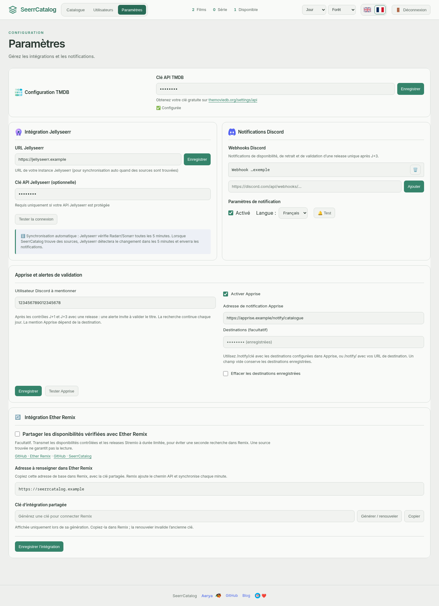 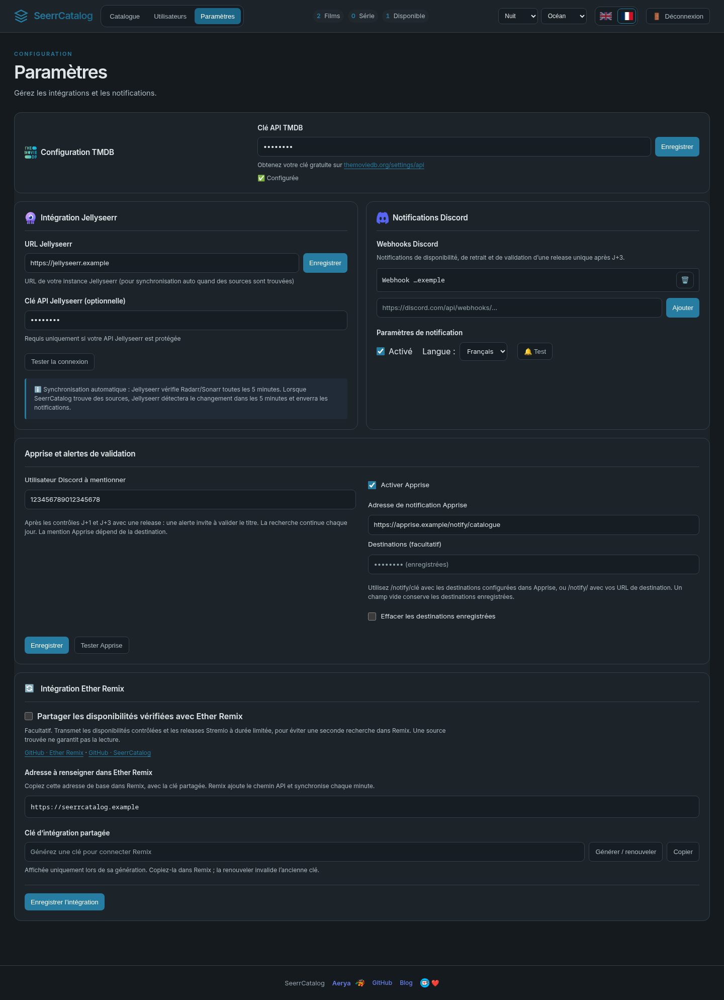</p>

## Captures d'écran

### WebUI SeerrCatalog

<p align="center">
  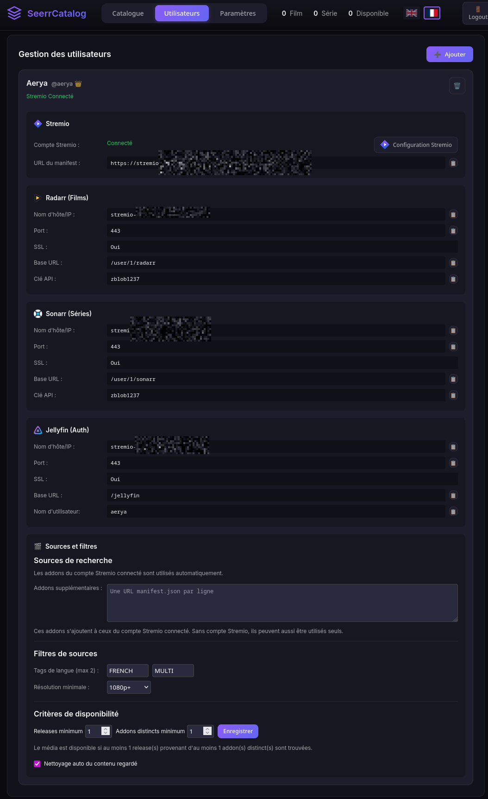
</p>
<p align="center"><sub>
Configuration complète d'un utilisateur : compte Stremio, endpoints Radarr / Sonarr / Jellyfin, addons supplémentaires, filtres et critères de disponibilité.
</sub></p>

<table>
  <tr>
    <td width="50%" align="center"><strong>Paramètres SeerrCatalog</strong></td>
    <td width="50%" align="center"><strong>Catalogue</strong></td>
  </tr>
  <tr>
    <td>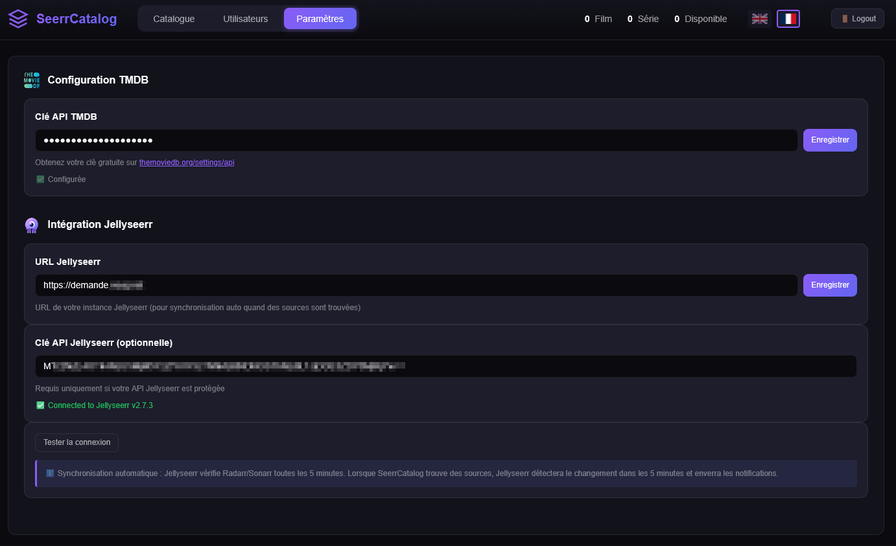</td>
    <td>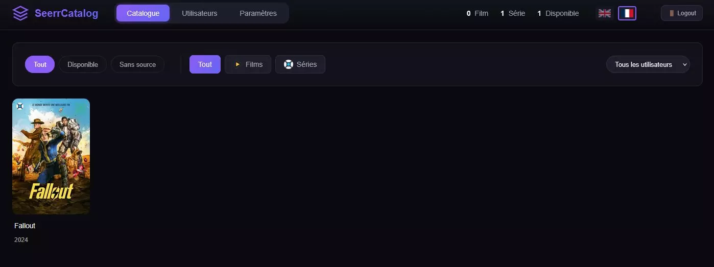</td>
  </tr>
  <tr>
    <td align="center"><sub>Configuration TMDB et intégration Jellyseerr.</sub></td>
    <td align="center"><sub>Catalogue personnel avec filtres par disponibilité, type et utilisateur.</sub></td>
  </tr>
</table>

### Intégration Jellyseerr

<table>
  <tr>
    <td width="50%" align="center"><strong>Services Radarr / Sonarr</strong></td>
    <td width="50%" align="center"><strong>Création d'une demande</strong></td>
  </tr>
  <tr>
    <td>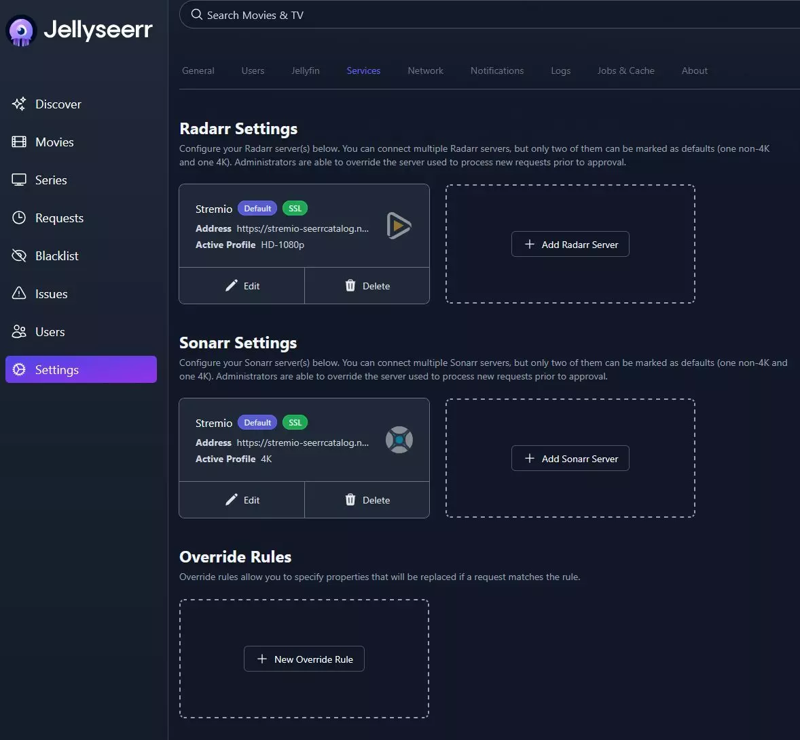</td>
    <td>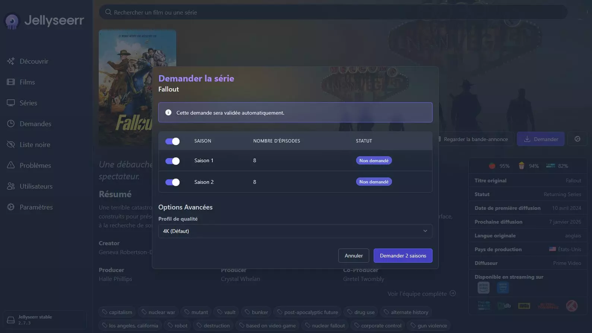</td>
  </tr>
  <tr>
    <td align="center"><sub>Jellyseerr pointe vers les endpoints Radarr et Sonarr émulés par SeerrCatalog.</sub></td>
    <td align="center"><sub>La demande reste effectuée normalement depuis Jellyseerr.</sub></td>
  </tr>
</table>

<p align="center">
  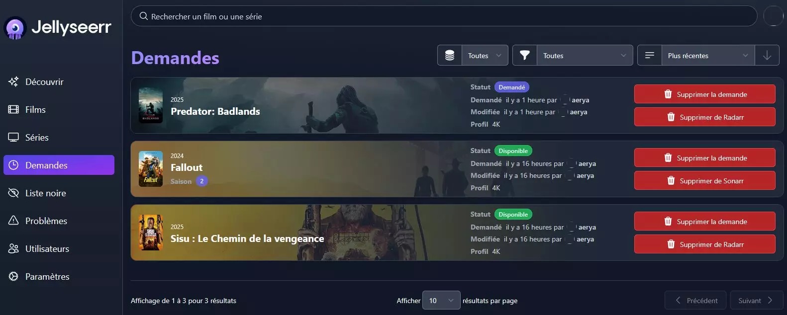
</p>
<p align="center"><sub>
Les demandes passent automatiquement à l'état disponible lorsque SeerrCatalog valide les critères de sources configurés.
</sub></p>

### Détection des sources

<p align="center">
  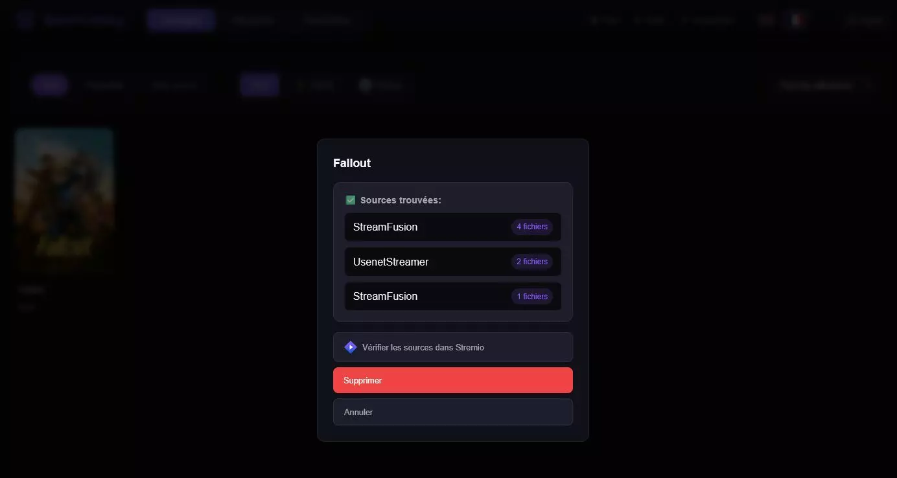
</p>
<p align="center"><sub>
Vue synthétique des addons ayant retourné des releases et du nombre de résultats trouvés.
</sub></p>

<p align="center">
  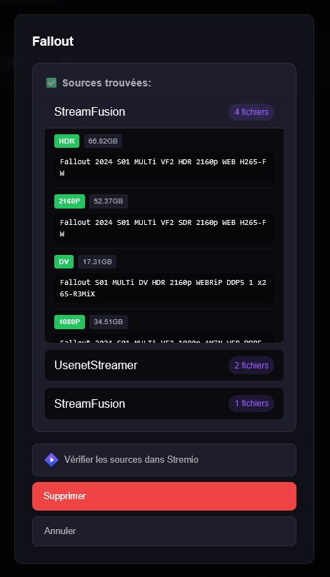
</p>
<p align="center"><sub>
Détail des releases retournées : addon, qualité, taille et nom de release.
</sub></p>

### Stremio et clients compatibles

<p align="center">
  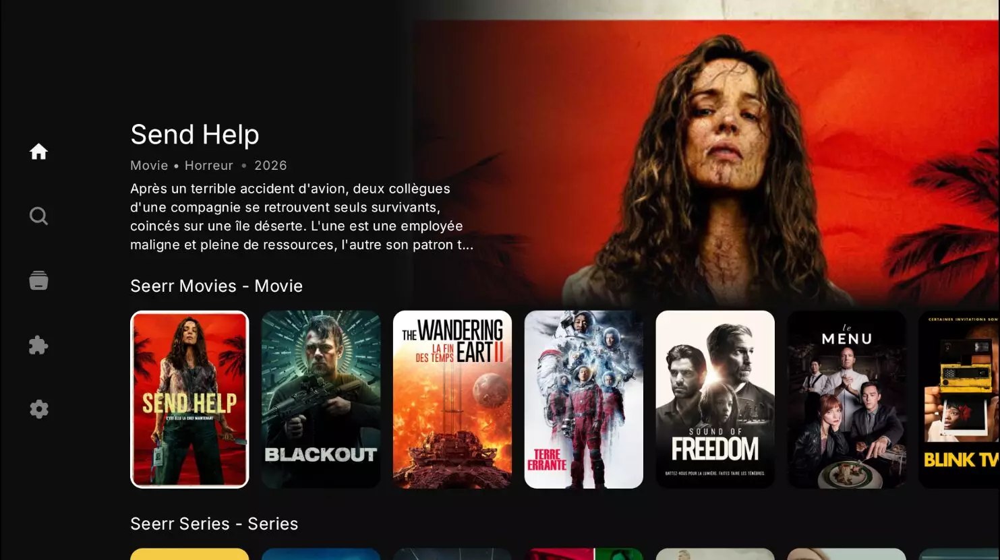
</p>
<p align="center"><sub>
Les catalogues générés par SeerrCatalog peuvent être consommés par les clients compatibles avec les addons Stremio, ici Nuvio.
</sub></p>
<!-- screenshots:end -->

## Variables d'environnement

| Variable | Description | Défaut |
|---|---|---|
| `PORT` | Port HTTP de SeerrCatalog | `7000` |
| `HOST` | Interface d'écoute | `0.0.0.0` |
| `TMDB_API_KEY` | Clé API TMDB utilisée pour les métadonnées | — |
| `BASE_URL` | URL publique, notamment derrière un reverse proxy | auto-détectée |
| `API_KEY` | Clé d'API exposée aux clients compatibles | — |

## Mise à jour

Avant la mise à jour, vérifie les [permissions du volume et l’utilisateur Docker](#utilisateur-docker-et-volumes-existants), notamment pour une ancienne installation exécutée en root.

Avec Docker Compose :

```bash
docker compose pull
docker compose up -d --force-recreate
```

Un simple `docker compose restart` ne suffit pas après un `pull` : il redémarre le conteneur existant avec l'image sur laquelle il a été créé.

Avec Dockge / Dockge-Enhanced, utilise donc **Pull & Recreate** pour appliquer une nouvelle image.

## Sécurité

Certaines URLs `manifest.json` peuvent contenir des jetons, clés ou paramètres privés.

- Ne publie pas ces URLs.
- Protège le volume `/app/data`, qui contient les paramètres de l'application.
- Utilise HTTPS si l'instance est exposée derrière un reverse proxy.
- Fixe `BASE_URL` à l'URL publique lorsque SeerrCatalog est utilisé derrière un proxy.

### Sécurité TLS — octobre 2026

Mise à jour des certificats et des composants TLS des images après l’incident eMudhra. Les contrôles couvrent les chaînes compromises, dont les deux cas « No CT », et une connexion HTTPS valide. Une image déjà en cours d’exécution reste inchangée : son remplacement doit être planifié après validation.

[Détails de l’incident](https://emudhra.we-have-a-problem.com/) · [TLS checks](security/emudhra/README.md)

## Documentation

Article et captures d'écran : [UpAndClear — SeerrCatalog, l'addon Over/Jelly/Seerr pour Stremio](https://upandclear.org/2026/01/03/seerrcatalog-laddon-over-jelly-seerr-pour-stremio/)

## Licence

MIT — voir [LICENSE](LICENSE).
