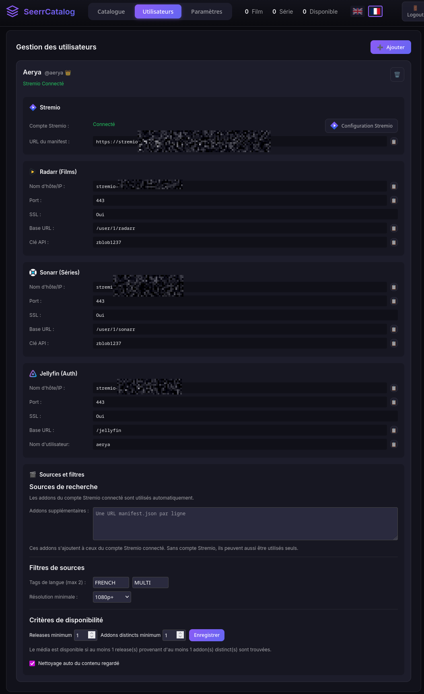
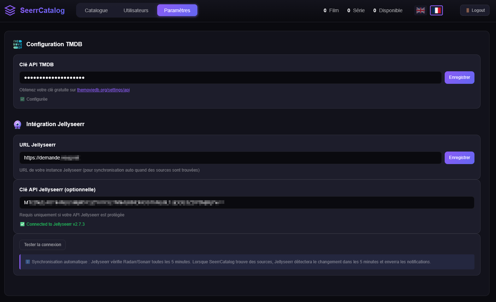
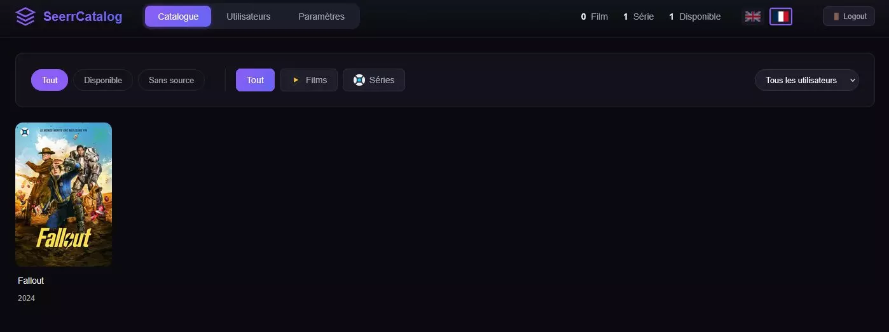
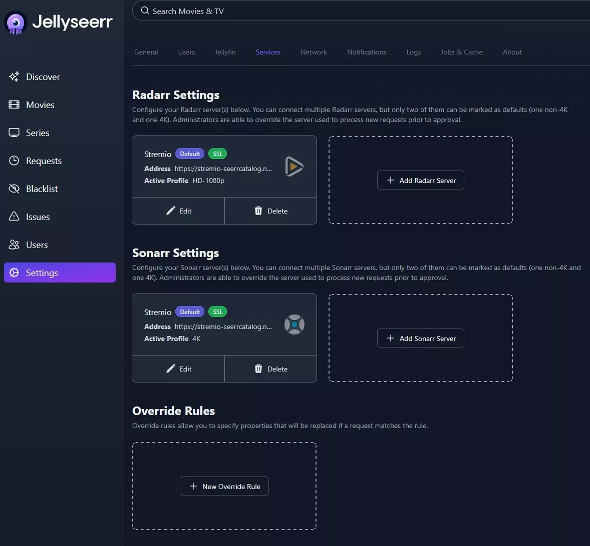
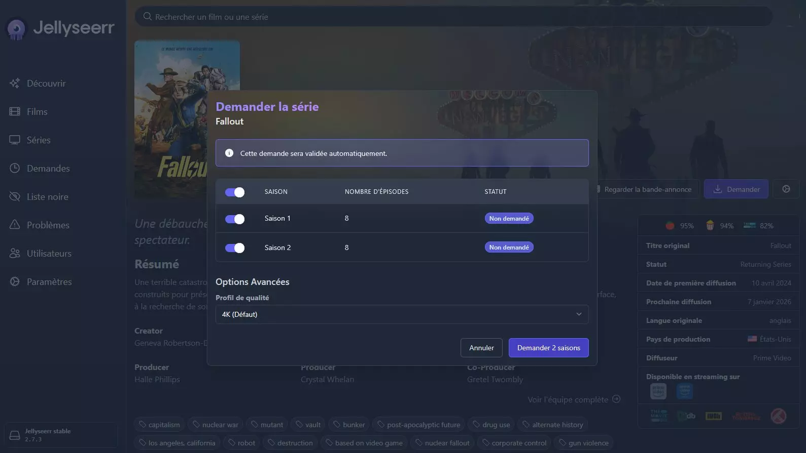
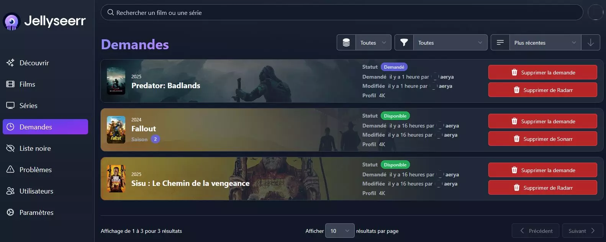
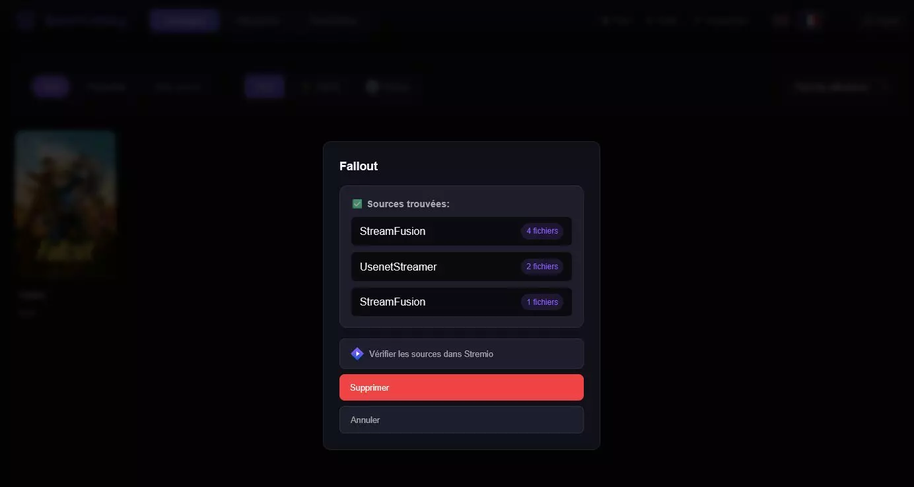
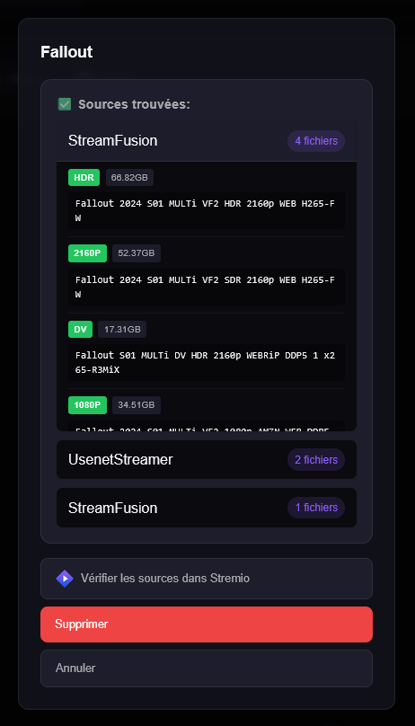
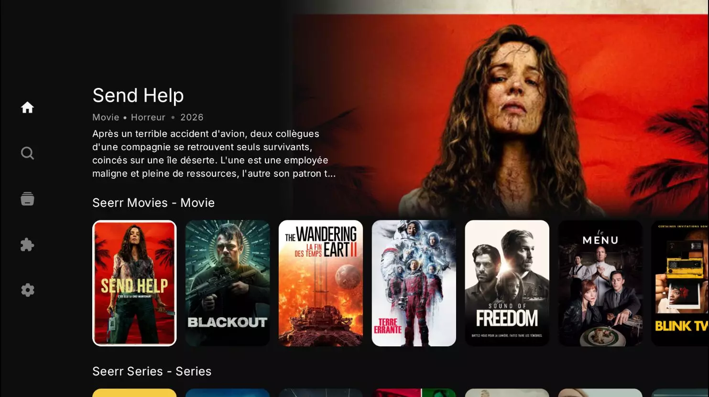

# SeerrCatalog

**Passerelle entre Jellyseerr et Stremio pour transformer les demandes de médias en catalogue personnel, sans téléchargement ni stockage de médias par SeerrCatalog.**

[English](README.en.md)

[](https://github.com/Aerya/Stremio-Seerr-Catalog/actions/workflows/docker-publish.yml)
[](https://github.com/Aerya/Stremio-Seerr-Catalog/pkgs/container/stremio-seerr-catalog)
[](https://github.com/Aerya/Stremio-Seerr-Catalog/pkgs/container/stremio-seerr-catalog)
[](README.en.md)
[](LICENSE)

SeerrCatalog se place entre Jellyseerr, Stremio et tes sources de streaming. Il expose les demandes Jellyseerr via une API compatible Jellyfin / Radarr / Sonarr, construit un catalogue Stremio personnel et contrôle la disponibilité réelle des médias avant de les déclarer disponibles.

### Sécurité TLS — octobre 2026

Mise à jour des certificats et des composants TLS des images après l’incident eMudhra. Les contrôles couvrent les chaînes compromises, dont les deux cas « No CT », et une connexion HTTPS valide. Une image déjà en cours d’exécution reste inchangée : son remplacement doit être planifié après validation.

[Détails de l’incident](https://emudhra.we-have-a-problem.com/) · [TLS checks](security/emudhra/README.md)

## Fonctionnement

```text
Jellyseerr
    |
    v
SeerrCatalog
    |
    +-- Catalogue Stremio personnel
    |
    +-- Vérification des releases
            |
            +-- Addons du compte Stremio
            +-- Addons supplémentaires (manifest.json)
                    |
                    v
            Filtres langue / résolution
                    |
                    v
            Seuil releases + seuil addons distincts
                    |
                    v
            Disponible / Sans source
```

Les addons supplémentaires ne remplacent pas les addons du compte Stremio : **ils s'y ajoutent**.

Exemple : si le compte Stremio utilise AIOStreams et que Lumio, StreamFusion et StreamNZB sont ajoutés manuellement, SeerrCatalog interroge l'ensemble de ces sources.

Sans compte Stremio lié, les manifests ajoutés manuellement peuvent également être utilisés seuls pour la vérification de disponibilité. Le compte Stremio reste nécessaire aux fonctions qui dépendent du compte, notamment la synchronisation de l'état regardé.

## Fonctionnalités

| Fonction | Description |
|---|---|
| Catalogue Stremio | Les demandes Jellyseerr deviennent un catalogue personnel accessible depuis Stremio. |
| Compatibilité Jellyseerr | Émulation des API Jellyfin, Radarr et Sonarr utilisées par Jellyseerr. |
| Addons du compte Stremio | Les addons disposant d'une ressource `stream` sont récupérés automatiquement depuis le compte lié. |
| Addons supplémentaires | Ajout d'URLs `manifest.json` compatibles avec le protocole Stremio. |
| Compatibilité addons | Fonctionne notamment avec AIOStreams, Lumio, StreamFusion, StreamNZB, LooStream et WaStream. |
| Filtres | Filtrage par tags de langue et résolution minimale. |
| Disponibilité configurable | Nombre minimum de releases et nombre minimum d'addons distincts configurables par utilisateur. |
| Multi-utilisateurs | Catalogue, sources, filtres et règles de disponibilité propres à chaque utilisateur. |
| Retry automatique | Nouvelle vérification quotidienne des médias sans source. |
| Synchronisation regardé | Les contenus regardés à au moins 90 % peuvent être automatiquement nettoyés du catalogue. |
| Notifications Discord | Notification lorsqu'aucune source correspondante n'est trouvée. |
| WebUI | Interface responsive en français et en anglais. |

<!-- screenshots:start -->
## Captures d'écran

### WebUI SeerrCatalog

<p align="center">
  
</p>
<p align="center"><sub>
Configuration complète d'un utilisateur : compte Stremio, endpoints Radarr / Sonarr / Jellyfin, addons supplémentaires, filtres et critères de disponibilité.
</sub></p>

<table>
  <tr>
    <td width="50%" align="center"><strong>Paramètres SeerrCatalog</strong></td>
    <td width="50%" align="center"><strong>Catalogue</strong></td>
  </tr>
  <tr>
    <td></td>
    <td></td>
  </tr>
  <tr>
    <td align="center"><sub>Configuration TMDB et intégration Jellyseerr.</sub></td>
    <td align="center"><sub>Catalogue personnel avec filtres par disponibilité, type et utilisateur.</sub></td>
  </tr>
</table>

### Intégration Jellyseerr

<table>
  <tr>
    <td width="50%" align="center"><strong>Services Radarr / Sonarr</strong></td>
    <td width="50%" align="center"><strong>Création d'une demande</strong></td>
  </tr>
  <tr>
    <td></td>
    <td></td>
  </tr>
  <tr>
    <td align="center"><sub>Jellyseerr pointe vers les endpoints Radarr et Sonarr émulés par SeerrCatalog.</sub></td>
    <td align="center"><sub>La demande reste effectuée normalement depuis Jellyseerr.</sub></td>
  </tr>
</table>

<p align="center">
  
</p>
<p align="center"><sub>
Les demandes passent automatiquement à l'état disponible lorsque SeerrCatalog valide les critères de sources configurés.
</sub></p>

### Notifications Discord — événements du catalogue

Les webhooks Discord existants sont utilisés pour les **sources trouvées** (ajout, vérification manuelle ou automatique), les **sources absentes confirmées** à l'ajout et les **retraits de contenus** (visionné, suppression WebUI, retrait Radarr/Sonarr). Les recherches répétées sans changement d'état n'envoient pas de doublon. Les notifications **« Sources trouvées »** détaillent les **filtres réellement appliqués** (langues et résolution minimale), le nombre de sources, les addons et les **releases regroupées par addon** (nom, qualité et taille si disponibles). La recherche conserve jusqu’à 50 noms par addon ; Discord répartit les résultats sur plusieurs champs et indique combien de releases ne sont pas affichées lorsque ses limites sont atteintes. Les liens IMDb/TMDB restent inchangés. Un média simplement marqué visionné mais conservé n'est pas considéré comme retiré. L'activation globale et la langue FR/EN existantes restent inchangées.

### Fiabilité des vérifications et notifications

- Lors d'un ajout Radarr/Sonarr, SeerrCatalog vérifie les sources en arrière-plan puis effectue **une seconde tentative après 60 secondes** si la disponibilité n'est pas confirmée. L'ajout Jellyseerr reste immédiat.
- Les erreurs réseau, délais d'attente, addons indisponibles ou identifiants IMDB manquants sont considérés comme des **vérifications incomplètes**, pas comme une preuve d'absence de sources. Le résultat précédemment enregistré est conservé en cas de vérification incomplète.
- Une notification Discord **« Aucune source trouvée »** est envoyée uniquement si deux vérifications concluantes ne trouvent **aucune release correspondant aux filtres**. Si des releases existent mais n'atteignent pas les seuils minimum définis, le média reste indisponible **sans fausse alerte « Aucune source »**.
- Pour les séries, la recherche teste prioritairement les saisons suivies (jusqu'à deux saisons récentes) puis `S01E01` comme solution de repli, au lieu de se limiter à `S01E01`.
- Les manifests directs et les addons du compte Stremio sont mémorisés brièvement (60 secondes) pour réduire les requêtes lors des ajouts groupés. Les vérifications de sources sont limitées à 4 requêtes simultanées, sans changer la configuration.
- Les boutons de copie affichent simplement une coche, sans popup. Une vérification manuelle incomplète s'affiche dans la fiche du média et ne remplace pas les résultats antérieurs.

### Interface WebUI revue

- Catalogue : filtres regroupés et identifiés, compteur de résultats, statuts de disponibilité directement visibles sur les affiches sans les masquer.
- Utilisateurs : configuration Stremio/Radarr/Sonarr/Jellyfin présentée en panneaux compacts et champs cohérents.
- Paramètres : intégrations TMDB, Jellyseerr et Discord réorganisées en panneaux adaptatifs ; interface et connexion harmonisées pour mobile.
- Détail des sources : liste dépliable accessible au clavier, actions de confirmation/suppression mieux différenciées ; traductions FR/EN complétées.
- Aucun changement de paramètres, endpoints, structure de stockage, Compose ou dépendances.

### Détection des sources

<p align="center">
  
</p>
<p align="center"><sub>
Vue synthétique des addons ayant retourné des releases et du nombre de résultats trouvés.
</sub></p>

<p align="center">
  
</p>
<p align="center"><sub>
Détail des releases retournées : addon, qualité, taille et nom de release.
</sub></p>

### Utilisation dans Stremio/Nuvio/whatever

<p align="center">
  
</p>
<p align="center"><sub>
Les catalogues générés par SeerrCatalog peuvent être consommés par les clients compatibles avec les addons Stremio, ici Nuvio.
</sub></p>
<!-- screenshots:end -->

## Règles de disponibilité

Deux valeurs indépendantes déterminent quand un média est considéré comme disponible :

- **Releases minimum** : nombre total de releases correspondant aux filtres.
- **Addons distincts minimum** : nombre de sources différentes devant retourner au moins une release.

| Releases minimum | Addons minimum | Exemple de règle |
|---:|---:|---|
| 1 | 1 | Au moins une release sur une source. |
| 2 | 1 | Au moins deux releases, même depuis un seul addon. |
| 1 | 2 | Au moins deux addons différents doivent trouver une release. |
| 3 | 2 | Au moins trois releases au total, provenant d'au moins deux addons. |

Par défaut, les deux valeurs sont à `1`, ce qui conserve le comportement historique.

## Installation

```yaml
services:
  seerr-catalog:
    image: ghcr.io/aerya/stremio-seerr-catalog:latest
    container_name: seerr-catalog
    ports:
      - "7000:7000"
    environment:
      - BASE_URL=http://localhost:7000
      - API_KEY=
      - PORT=7000
      - HOST=0.0.0.0
      - TMDB_API_KEY=
    volumes:
      - /mnt/Docker/stremio/seerrcatalog:/app/data
    restart: always
```

Démarrage :

```bash
docker compose up -d
```

## Configuration

1. Ouvre `http://localhost:7000`.
2. Crée le compte administrateur.
3. Configure la clé TMDB.
4. Lie un compte Stremio si tu veux utiliser automatiquement ses addons et la synchronisation de lecture.
5. Dans **Utilisateurs > Sources et filtres**, configure si nécessaire les addons supplémentaires, les filtres et les seuils de disponibilité.
6. Configure Jellyseerr avec les informations Radarr / Sonarr affichées par SeerrCatalog.
7. Installe le manifest SeerrCatalog dans Stremio.

### Sources de recherche

Pour chaque utilisateur :

- les addons du compte Stremio connecté sont chargés automatiquement ;
- les manifests saisis dans **Addons supplémentaires** sont ajoutés au même pool ;
- un même transport Stremio n'est interrogé qu'une fois s'il apparaît dans les deux listes ;
- les filtres sont appliqués aux releases retournées ;
- les seuils de disponibilité sont évalués sur le résultat combiné.

Les URLs de manifests sont propres à chaque utilisateur.

## Variables d'environnement

| Variable | Description | Défaut |
|---|---|---|
| `PORT` | Port HTTP de SeerrCatalog | `7000` |
| `HOST` | Interface d'écoute | `0.0.0.0` |
| `TMDB_API_KEY` | Clé API TMDB utilisée pour les métadonnées | — |
| `BASE_URL` | URL publique, notamment derrière un reverse proxy | auto-détectée |
| `API_KEY` | Clé d'API exposée aux clients compatibles | — |

## Mise à jour

Avec Docker Compose :

```bash
docker compose pull
docker compose up -d --force-recreate
```

Un simple `docker compose restart` ne suffit pas après un `pull` : il redémarre le conteneur existant avec l'image sur laquelle il a été créé.

Avec Dockge / Dockge-Enhanced, utilise donc **Pull & Recreate** pour appliquer une nouvelle image.

## Sécurité

Certaines URLs `manifest.json` peuvent contenir des jetons, clés ou paramètres privés.

- Ne publie pas ces URLs.
- Protège le volume `/app/data`, qui contient les paramètres de l'application.
- Utilise HTTPS si l'instance est exposée derrière un reverse proxy.
- Fixe `BASE_URL` à l'URL publique lorsque SeerrCatalog est utilisé derrière un proxy.

## Documentation

Article et captures d'écran : [UpAndClear — SeerrCatalog, l'addon Over/Jelly/Seerr pour Stremio](https://upandclear.org/2026/01/03/seerrcatalog-laddon-over-jelly-seerr-pour-stremio/)

## Licence

MIT — voir [LICENSE](LICENSE).
